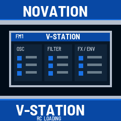
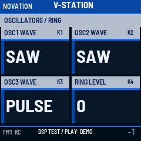
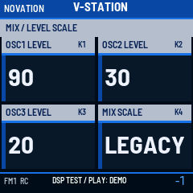
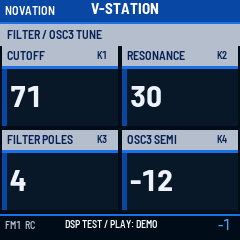
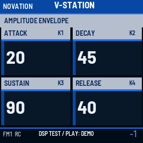
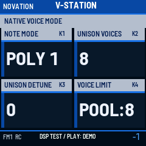
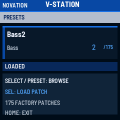
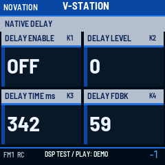

# FM1 V-Station RC

FM1 V-Station RC is an independent FM1 port/reconstruction inspired by the Novation V-Station architecture. **8-voice shared dynamic pool** and **up to 8 unison voices**.

## Highlights

- **8 physical voices** in one shared dynamic pool — POOL 1..8, default 8
- **UNISON VOICES 1..8**
- global whole-group voice stealing
- dual-core 4+4 rendering at a full eight-voice load
- transient steal/rebuild CPU optimizations for heavy 7x-8x unison cases
- 175 retained factory presets / 13 categories
- 170 active synth parameters
- USB-C Web MIDI editor with JSON preset import/export and persistent browser user library
- visible source, build scripts and prebuilt firmware in this repository

## Unison / voice page

`NATIVE VOICE MODE` is intentionally near the front of the ENV navigation now. From HOME, press **ENV twice**.

- **K1:** NOTE MODE
- **K2:** UNISON VOICES — 1..8
- **K3:** UNISON DETUNE
- **K4:** VOICE LIMIT / POOL — 1..8

At 1x unison the pool can provide eight notes; at 2x, four notes; at 4x, two notes; at 5x-8x, one note can occupy most or all of the pool.

## Firmware

- [Download the FWSC application update](https://github.com/Kayman18/FM1-VStation/releases/download/RC/FM1-VStation-RC.fwsc)
- [GitHub release and notes](https://github.com/Kayman18/FM1-VStation/releases/tag/RC)
- [Complete M-Flasher image](release/FM1-VStation-RC-M-Flasher.bin)

Keep your own full-device backup before using the complete M-Flasher image.

## Firmware screens

These 240 × 240 screenshots were captured in the simulator using the RC firmware's display code.

| Startup | Oscillators | Mixer |
| --- | --- | --- |
|  |  |  |

| Filter | Amplitude envelope | Native voice mode |
| --- | --- | --- |
|  |  |  |

| Presets | Delay |
| --- | --- |
|  |  |

## Source

- [Browsable source](source/)
- [Matching source archive](release/FM1-VStation-RC-Source.zip)

The source tree includes the app, engine, fm1-base platform snapshot, tests, web editor generator and build scripts. Large external build inputs are documented in `DEPENDENCIES.md`.

## Building

Set `JIELI_TOOLCHAIN` to the validated JieLi toolchain, or place `jieli-linux-toolchains-20260730.1.tar.xz` under `source/toolchain/`.

```bash
cd source
bash build.sh
```

To build the host simulator, run this from the repository root.

```bash
cd source
bash build.sh --host
```

The complete M-Flasher image additionally requires the pinned reference full image documented in `DEPENDENCIES.md`; the normal `.fwsc` does not.

## Web editor

Use `web-editor/index.html` from `source/` or `release/FM1-VStation-RC-Web-Editor.zip`. Connect the FM1 over USB-C with a Web MIDI/SysEx-capable Chromium browser.

The Hardware tab exposes POOL 1..8, DUAL/SINGLE mode, scan diagnostics and live performance telemetry.

## Validation / resources

Current RC target footprint:

- Application: **573,276 / 581,564 bytes**
- Main RAM: **95,056 / 98,304 bytes**
- FX/large-buffer pool: **335,692 / 344,064 bytes**
- Firmware identity: **`FM-1_15010000`**

See `RC-RELEASE-NOTES.md` and `release/SHA256SUMS.txt` for validation details and hashes.

## Licensing / provenance

The FM1 platform layer is based on `fm1-base` / Felucca BSP and retains applicable open-source licensing. No Novation proprietary source code is included. This is an independent reconstruction/port from supplied executable/data behavior and public operating information.
